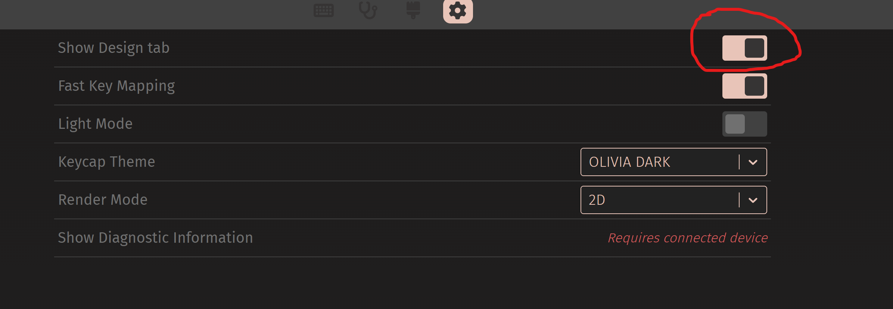
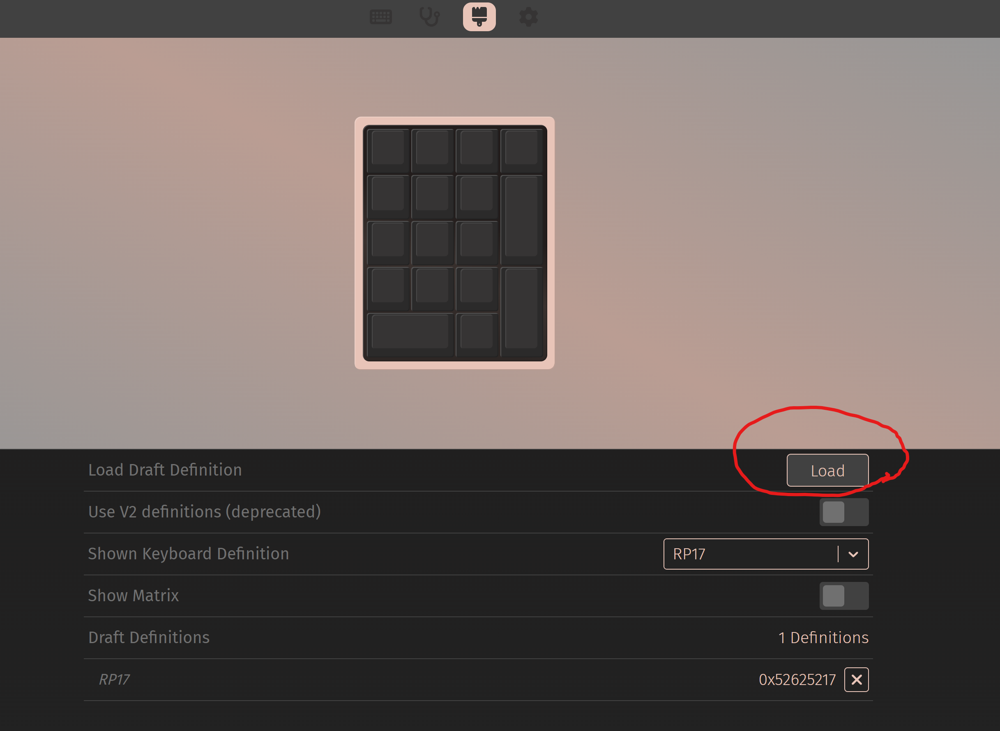
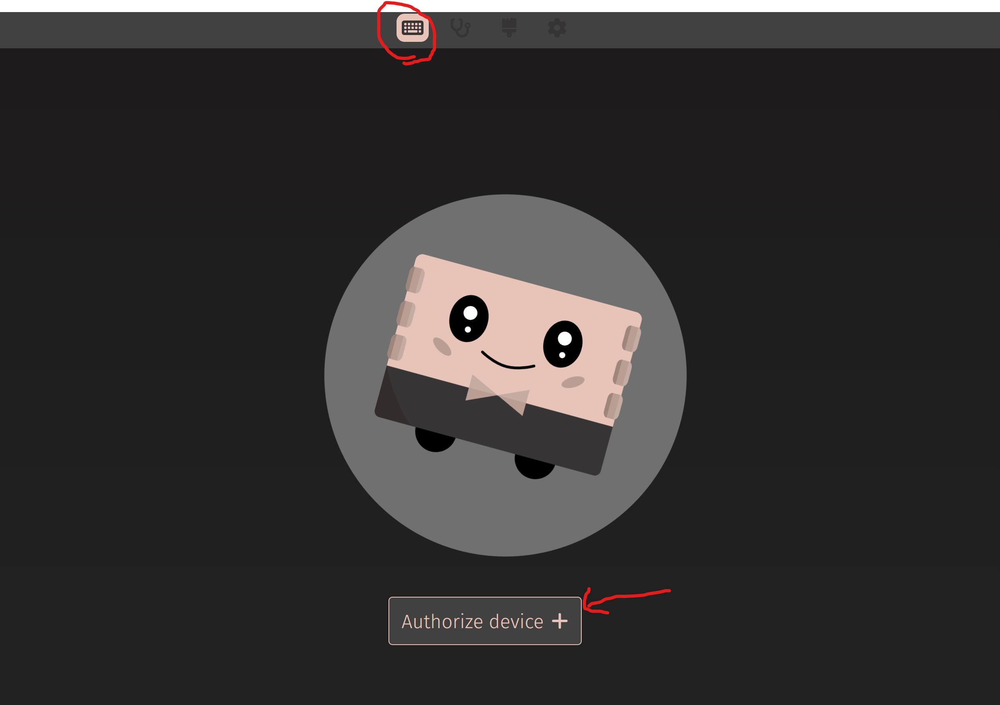
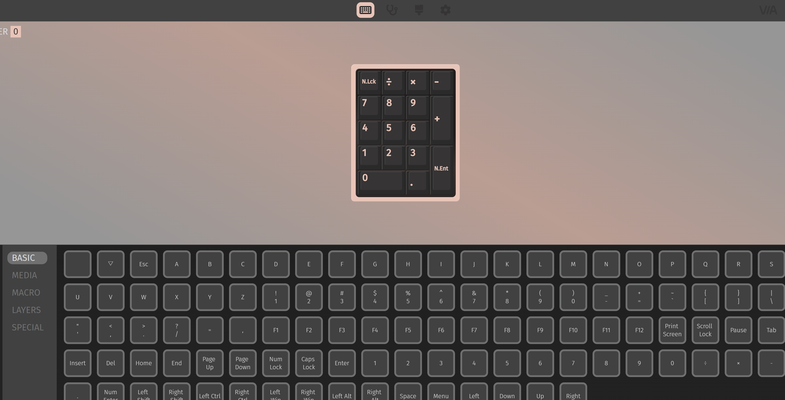
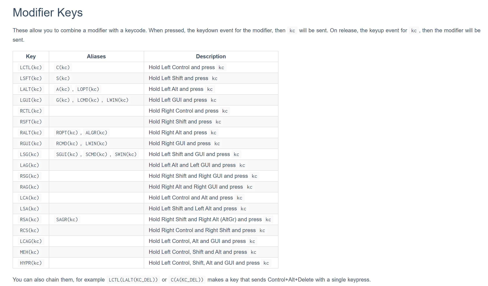
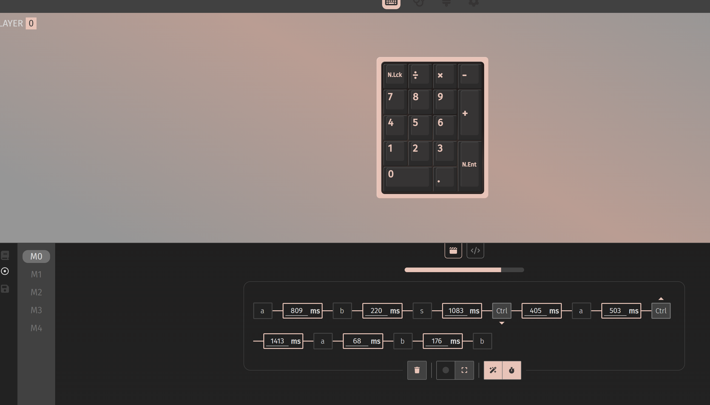

## 适配轻量qmk功能到ch552, 基于ch55xduino

### 功能特性

* via改键，可设置为普通键，多媒体键，系统控制键，鼠标键，Surface Dial键
* 双层按键切换，via可设置任意键切层或按住任意键切层
* 按键复用功能，任意键可设置为复用键，最多5个复用键，每个复用键可通过via设置单击、双击、按住三种操作
* via可录制宏，发送字符串，可设置宏循环次数1-254，最大值时255时为无限循环。再次按宏停止，发宏不影响其他按键操作
* via里宏设置可输入KC_F13-KC_F21键代替鼠标键。能设置鼠标宏，做鼠标连点器，游戏宏等
  对应关系：KC_F13->鼠标左键，KC_F14->右键，KC_F15->中键，KC_F16-KC_F19—>指针上下左右，KC_F20->滚轮上滚，KC_F21->滚轮下滚
* 适配ws2812 RGB，标配via设置RGB值的本地模式，signalrgb神光同步模式，电脑软件直接驱动RGB，支持多种灯效，音乐律动等等
* 适配6种本地hue颜色循环模式，via可设置灯效切换按键或在via里设置灯效
* 适配编码器

### 待更新

* 触摸按键

### 使用方法

1. 克隆本仓库
2. 复制 `keyboards/` 下已有板卡目录并改名，修改默认键值：`keymap.h`，修改功能配置：`config.h`，修改 `***_via.json` 适配 VIA，修改 `***_signalrgb.js` 适配 SignalRGB，参考 [signalrgb](https://docs.signalrgb.com/qmk/building-firmware-from-source) 修改 js 文件。
3. 在 `firmware/boards.json` 增加一条板卡记录：id / name / productId / vpid / directory / viaJson / signalRgb / hex。不同板卡须使用不同的 USB PID（VIA 靠 VID/PID 区分设备），`vpid = vendorId * 65536 + productId`。
4. 本地脚本构建：`python build.py --board <id>`，自检：`python verify.py --board <id>`；省略 `--board` 时使用清单里的 `default`，`python build.py --list` 列出全部板卡。
5. 用 Arduino IDE 编译时需在编译参数中加 `-DBOARD_ID=<directory>`；未定义时 `config_common.h` 使用默认板。
6. 用Arduino IDE打开修改后的`CH55x_QMK_Lite.ino`文件
7. 安装[CH55xduino](https://github.com/DeqingSun/ch55xduino)，本项目使用版本0.0.18验证。
8. 在`USB Settings` 中选择 `USER CODE w/ 266B ram`
9. 编译上传，需要安装驱动，安装方式参考[CH55xduino](https://github.com/DeqingSun/ch55xduino)，中文说明[CH55xduino](https://github.com/lbtrobit/ch55xduino)
10. 如果功能选项多开空间不足，可注释掉CH55xDuino main.c文件里没用到的部分，例如安装路径下：C:\Users\Public\AppData\Local\Arduino15\packages\CH55xDuino\hardware\mcs51\0.0.18\cores\ch55xduino\main.c，注释掉Timer2Interrupt(void)、GPIOInterrupt(void)、Uart0_ISR(void)、Uart1_ISR(void)、INT0_ISR(void)、INT1_ISR(void)这几个本项目没用到的中断函数，可多出1k rom。

### 本项目使用以下项目资源，感谢相关作者的无私奉献

1. [CH55xduino](https://github.com/DeqingSun/ch55xduino)
2. [qmk](https://github.com/qmk/qmk_firmware)
3. [via](https://github.com/the-via/app)
4. [signalrgb](https://signalrgb.com/)

### 本项目参考学习以下项目代码，感谢相关作者的无私奉献

1. [qmk-zhaqian12](https://github.com/zhaqian12/qmk_firmware)
2. [qmk_port_ch582](https://github.com/O-H-M2/qmk_port_ch582)

# 小白使用文档

## 改键

同QMK使用VIA改键，网页地址：[VIA](https://usevia.app/)

1. 开启导入json文件面板
  

2. 点击load导入json文件
  

3. 添加键盘
   

4. 先选要改的按键，然后选下面的按键，可以选普通键，多媒体键，系统键，鼠标键，宏键(M0-M4)等。部分特殊功能键不支持，比如layers里面的。
   

5. 组合键使用special最下面的any键输入，比如ctrl+c则输入LCTL(KC_C)。或者使用宏录制。
   
   
6. 可录制5个宏，每个宏可长可短，因dataflash有限，只有78字节。宏有字符串（1个字符一个字节）和操作步骤（一个操作4字节，较费dataflash），可记录按键间隔。保存不了就是空间不足，要减掉几个步骤才能保存。
   
   